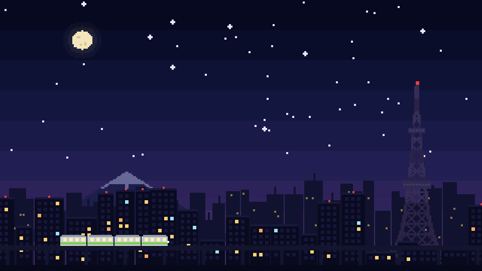

# Tokyo Tower — a context-aware theme for Claude Code

A pixel-art Tokyo night behind your Claude Code chat. Tokyo Tower shines bright when the
conversation starts and slowly goes dark as the context window fills up, so you can tell
at a glance how much room is left.

| Fresh context | Half full | Nearly full |
| --- | --- | --- |
|  |  |  |

## What changes with the context

The light level goes from 10 (empty context) down to 0 (80% full, where auto-compaction
usually kicks in). As it drops:

- Tokyo Tower switches off from the top down, its glow and observation decks with it.
- City windows go dark, from about 90% lit down to 10%.
- Neon signs switch off one by one, starting from the farthest from the tower.
- Above level 7 two searchlights sweep the sky; at full light the tower sparkles.
- The sky loses its city glow and the stars come back out.

After a compaction the context is small again and the city lights back up.

Always there: the moon, Mount Fuji on the horizon, a commuter train crossing every
36 seconds, and slow red aviation lights. Motion is slow and never flashes; with reduced
motion turned on, the scene holds still in a finished pose.

The theme is dark only. Your own messages get square bubbles with an orange outline and a
hard pixel shadow.

## Install

At the prompt of a Claude Code terminal session:

```
/plugin install tokyo-tower --marketplace savinofiore/claude-tokyo-tower
```

Answer `y` to add the marketplace, then pick a scope (the user scope gives every session
the theme).

From a shell:

```bash
claude plugin install tokyo-tower --marketplace savinofiore/claude-tokyo-tower
```

In the desktop app, where `/plugin` does not run: click + next to the prompt box, then
Plugins, Add marketplace with `savinofiore/claude-tokyo-tower`, then Add plugin.

To remove it:

```bash
claude plugin uninstall tokyo-tower
```

## Where it shows

The backdrop is drawn by the Claude desktop and mobile apps. The terminal and editor
integrations draw no themes, so there the plugin does nothing.

## Development

The plugin is a hooks module (`hooks/register.tsx`) that sets the look at
`session.start`, reads the context fill from `session.measure`, and draws the scene as an
SVG in a `Backdrop` render hook. The scene is generated in `hooks/scene.ts`, `sky.ts`,
`city.ts` and `tower.ts`.

```bash
claude plugin validate .
claude plugin test .
```

To try local changes, start Claude Code with `claude --plugin-dir <this folder>`.

## License

MIT
