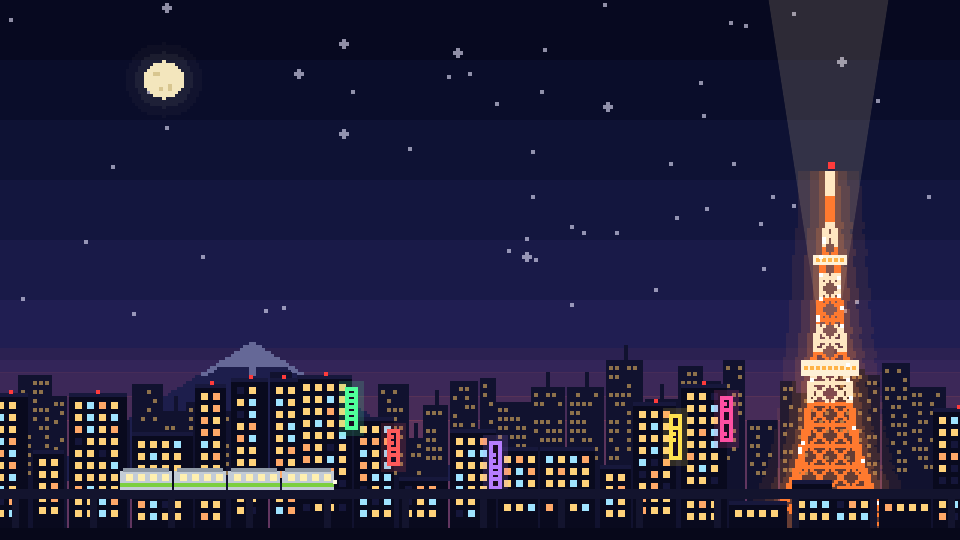
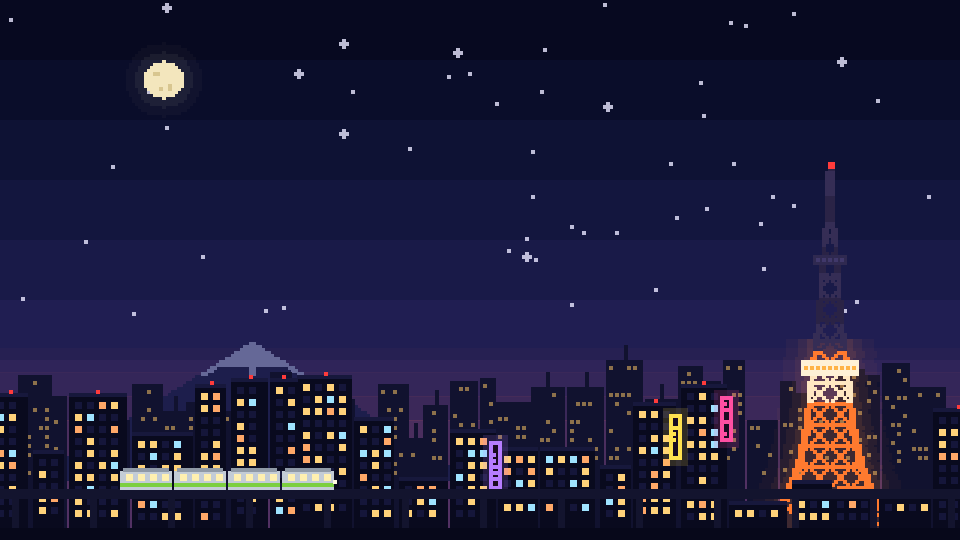
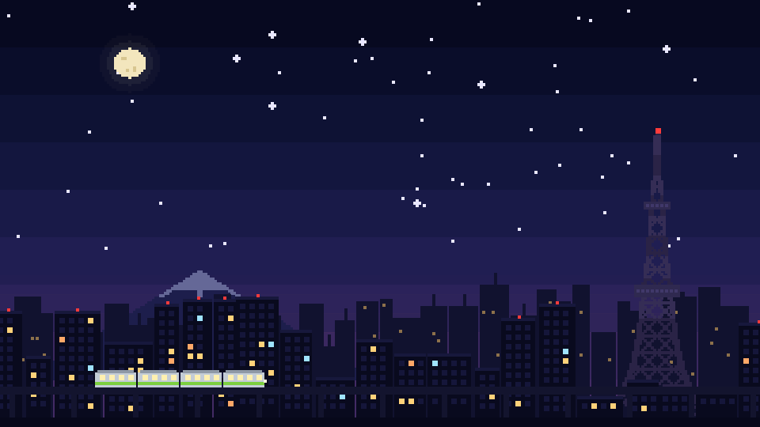

# Tokyo Tower — a context-aware theme for Claude Code

A Tokyo night behind your Claude Code chat, in the style you pick at install: cinematic or
pixel-art. Tokyo Tower shines bright when the
conversation starts and slowly goes dark as the context window fills up, so you can tell
at a glance how much room is left.

| Style | Fresh context | Half full | Nearly full |
| --- | --- | --- | --- |
| Cinematic |  |  |  |
| Pixel |  |  |  |

## What changes with the context

The light level goes from 10 (empty context) down to 0 (80% full, where auto-compaction
usually kicks in). As it drops:

- Tokyo Tower switches off from the top down, its glow and observation decks with it.
- City windows go dark, from about 90% lit down to 10%.
- Neon signs switch off one by one, starting from the farthest from the tower.
- Above level 7 two searchlights sweep the sky; at full light the tower sparkles.
- The sky loses its city glow and the stars come back out.

After a compaction the context is small again and the city lights back up.

Always there: the moon, Mount Fuji on the horizon, a commuter train crossing every
36 seconds, and slow red aviation lights. Motion is slow and never flashes; with reduced
motion turned on, the scene holds still in a finished pose.

## Styles

- **cinematic** (the default): smooth vector art, sharp at any resolution. In the desktop app a
  GPU shader plays over it for a filmed look: bloom around every light, a slow haze lit by the
  city, a hint of lens fringing at the edges, a vignette and a fixed film grain. Where shaders
  don't play (the mobile apps, Reduce Motion, a slow GPU) the same scene shows without the film
  pass. Your own messages get rounded bubbles with an orange outline and a soft shadow.
- **pixel**: the original pixel-art scene, with square bubbles and a hard pixel shadow.

Install asks which one you want, and whether the cinematic style plays the film effect
(**Film effect**, on by default; off shows the plain vector scene). To switch later, change **Style** under the plugin's options
in `/config`, or set it in `~/.claude/settings.json`:

```json
"pluginConfigs": { "tokyo-tower@claude-tokyo-tower": { "options": { "style": "cinematic", "film": false } } }
```

Both are dark only.

## Install

At the prompt of a Claude Code terminal session:

```
/plugin install tokyo-tower --marketplace savinofiore/claude-tokyo-tower
```

Answer `y` to add the marketplace, then pick a scope (the user scope gives every session
the theme).

From a shell:

```bash
claude plugin install tokyo-tower --marketplace savinofiore/claude-tokyo-tower
```

In the desktop app, where `/plugin` does not run: click + next to the prompt box, then
Plugins, Add marketplace with `savinofiore/claude-tokyo-tower`, then Add plugin.

To remove it:

```bash
claude plugin uninstall tokyo-tower
```

## Where it shows

The backdrop is drawn by the Claude desktop and mobile apps. The terminal and editor
integrations draw no themes, so there the plugin does nothing.

## Warp terminal

The `warp/` folder holds a Warp theme with the same palette and the scene as its
background, in both styles (`warp/cinematic/` and `warp/pixel/`), rendered at 3840×2160 at
every light level (`tokyo_tower_<build>_0.png` dark to `_10.png` fully lit). Copy the style
you want (here `cinematic`):

```bash
mkdir -p ~/.warp/themes && rm -f ~/.warp/themes/tokyo_tower* && cp warp/cinematic/tokyo_tower* ~/.warp/themes/
```

Then pick **Tokyo Tower** in Warp under Settings → Appearance → Themes (turn off "Sync with
OS", or set it as the dark theme).

To make the city dim with the context, as in the desktop app, use the bundled status line.
On every refresh it points the theme at the image for the current light level, and Warp
reloads the theme by itself. The lights count tokens against a 200k scale (dark at 160k
tokens), so they still move with 1M-token models. It only touches the theme from sessions running in Warp, and
needs `jq`:

```bash
cp warp/tokyo-tower-statusline.sh ~/.claude/
```

and in `~/.claude/settings.json`:

```json
"statusLine": { "type": "command", "command": "~/.claude/tokyo-tower-statusline.sh", "padding": 0 }
```

The Warp theme is shared by all windows, so with several Claude sessions open it follows
whichever refreshed last. To regenerate the images after changing the scene, run
`bun scripts/build-warp-theme.ts` (needs ImageMagick and Google Chrome); it rebuilds both styles.

## Development

The plugin is a hooks module (`hooks/register.tsx`) that sets the look at
`session.start`, reads the context fill from `session.measure`, and draws the scene as an
SVG in a `Backdrop` render hook. `hooks/styles.ts` picks the style from the plugin's options.
Each style has its own folder, `hooks/cinematic/` (with the film shader, `cinema.ts`) and
`hooks/pixel/`, each building its scene in `scene.ts`, `sky.ts`, `city.ts` and `tower.ts`.

```bash
claude plugin validate .
claude plugin test .
```

To try local changes, start Claude Code with `claude --plugin-dir <this folder>`.

## Contributing and security

Pull requests are welcome: see [CONTRIBUTING.md](CONTRIBUTING.md). To report a
vulnerability privately, see [SECURITY.md](SECURITY.md).

## License

MIT
